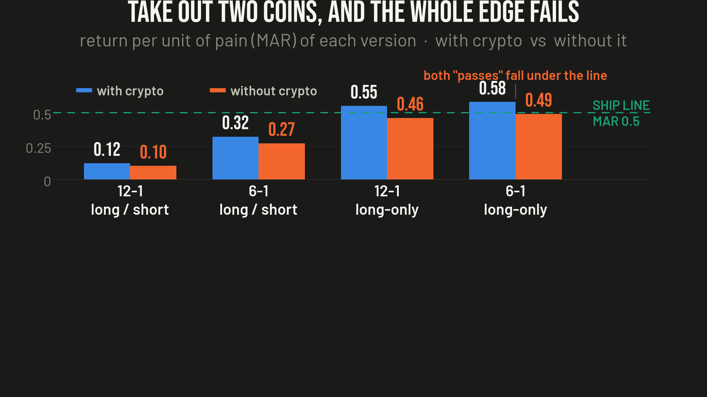

# The Momentum Factor, Retail Edition — Kill-Test (Backtest Graveyard source)

**Episode:** Ep15 · **Channel:** The Backtest Graveyard
**Question:** cross-sectional momentum is the strategy finance professors actually respect: rank a basket by its trailing 6–12 month return, buy the top third, short the bottom third, rebalance monthly. It is the most documented anomaly in finance. Does the version a regular person could run clear the channel's bar?
**Data:** Yahoo Finance daily bars (via `yfinance`, auto-adjusted for dividends and splits), **2010-01-04 → 2026-06-29** (4,146 trading days, ~16.5 yrs), **29 liquid names**: broad indices (SPY QQQ IWM DIA MDY), all nine SPDR sectors, metals/energy/commodity (GLD SLV DBC USO UNG), rates/credit (TLT IEF LQD HYG), four mega-cap stocks (AAPL NVDA MSFT AMZN), and BTC/ETH. The panel is ragged: Bitcoin enters in Sept 2014 and Ethereum in Nov 2017, and each is ranked only once it has a full lookback.
**Strategy (standard academic construction, parameters NOT tuned to this data):** 12-1 and 6-1 month momentum (the most recent month is skipped to avoid short-term reversal), ranked every 21 trading days, equal-weight tercile legs, held to the next rebalance. Long/short = long the top third, short the bottom third, dollar-neutral. Long-only = the top third only. Costs: 3 bps per unit of turnover (6 bps in the 2× run). Fixed gross exposure, no volatility targeting.
**Bar to pass:** **MAR (CAGR / max drawdown) ≥ 0.50 AND Sortino ≥ 1.00.**

Code: `xsmom_backtest.py` (numpy, pandas, yfinance; no secrets, no accounts). Output: `RESULTS.md`, regenerated on every run.

## Headline

**The effect is real. The version you could run is Bitcoin and Nvidia.** The long/short factor the papers describe fails clearly. Drop the short side and long-only "passes" at MAR 0.55–0.58, but with a **−68% drawdown**, and it leans on five great months. The top 5 names were **42% of the gross profit**. Remove the two coins and **all four versions fail**.

## Results (full universe)

| Config | MAR | Sortino | CAGR | Max DD | 2×-cost MAR | Bar |
|---|--:|--:|--:|--:|--:|:--:|
| 12-1 long/short (dollar-neutral) | 0.12 | 0.39 | 6.3% | −51.5% | 0.12 | FAIL |
| 6-1 long/short (dollar-neutral) | 0.32 | 0.75 | 11.1% | −34.6% | 0.31 | FAIL |
| 12-1 long-only top third | 0.55 | 1.13 | 37.9% | −69.2% | 0.55 | nominal PASS |
| 6-1 long-only top third | 0.58 | 1.19 | 39.9% | −68.3% | 0.58 | nominal PASS |

## Kill-Test 1 — The real version (long/short)

Both long/short books fail (MAR 0.12 and 0.32). In a market that mostly went up for 15 years, the short leg keeps betting against things that drift up with the tide. It also can't be run in a normal brokerage account: holding a 10-name short book for years needs margin, borrow and a short-enabled account most people don't have.

## Kill-Test 2 — The drawdown on the "pass"

The long-only versions clear MAR and Sortino, but their worst peak-to-trough loss is **−68% to −69%**. A strategy most people would actually deploy keeps its drawdown in single digits to about −11%. Very few people sit through −68%.

## Kill-Test 3 — Strip the 5 best months

On the strongest config (6-1 long-only), zeroing the five best calendar months drops it to **MAR 0.44, Sortino 0.97**, back under the bar on both counts. The nominal pass leans on a handful of months.

## Kill-Test 4 — Where the profit came from, and the no-crypto re-run

Top-5 names = **42% of gross P&L** (6-1 long-only), by contribution: **BTC +83%, NVDA +80%, AMZN +46%, AAPL +45%, ETH +39%**. Bitcoin's own price went from $457 (2014-09-17, its first bar in this panel) to about $60,100 (2026-06-29), **+13,050%** (the episode says "more than 8,000%").

The same four configs with BTC and ETH removed (27 names):

| Config | MAR | Sortino | CAGR | Max DD | Bar |
|---|--:|--:|--:|--:|:--:|
| 12-1 long/short | 0.10 | 0.27 | 4.2% | −42.3% | FAIL |
| 6-1 long/short | 0.27 | 0.61 | 8.6% | −32.2% | FAIL |
| 12-1 long-only | 0.46 | 1.01 | 31.4% | −68.3% | FAIL |
| 6-1 long-only | 0.49 | 1.06 | 33.3% | −68.3% | FAIL |



## The GREEN keeper (what the data actually supports)

Momentum as an academic effect is genuine: across long windows and many markets, winners tending to keep winning is one of the most robust findings in finance. Nothing here contradicts that. What this test says is narrower: the retail-runnable version (no shorting, survivable drawdown) reduces to "own strength, and don't sell winners too early." Holding a broad index, the mega-cap names or a little Bitcoin already does that, without the −68% drawdown or the monthly rebalancing.

## Verdict

**For a regular person: no, not as a strategy to run.** The real long/short factor loses on this data and can't be traded in a normal account. The long-only version passes only by carrying a −68% drawdown, barely passes even then, and fails on every config once the two coins come out. What's left is concentrated beta in whatever already went up.

## Reproduce

```bash
pip install numpy pandas yfinance
python3 xsmom_backtest.py          # downloads to ./cache/ on first run, writes RESULTS.md
python3 xsmom_backtest.py --refresh  # force a fresh download
```

Yahoo revises history from time to time, so a fresh download can move the second decimal. Not investment advice.
