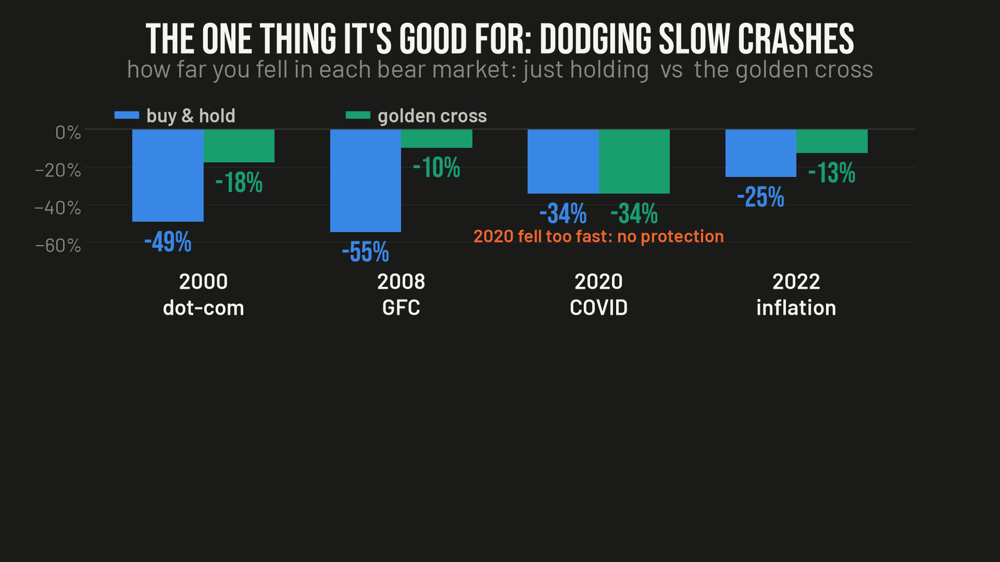
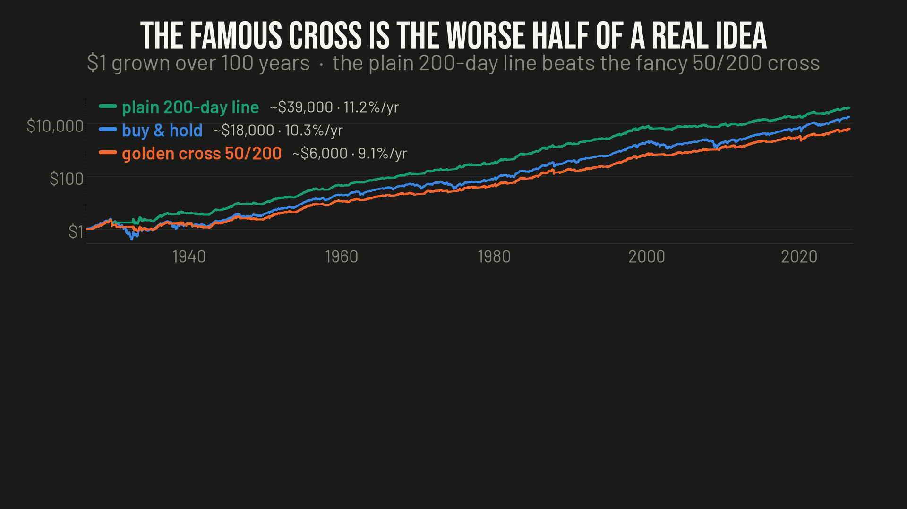

# The Golden Cross (50/200) — Kill-Test (Backtest Graveyard source)

**Episode:** Ep16 · **Channel:** The Backtest Graveyard
**Question:** the most-searched indicator belief on the internet: buy when the 50-day moving average crosses above the 200-day (the "golden cross"), sell to cash when it crosses back below (the "death cross"). Does dodging bear markets with a 50/200 cross beat just buying and holding?
**Data:** daily **total return** (dividends reinvested) from the **Fama-French daily research factors** (Ken French data library, Dartmouth). `Mkt = (Mkt-RF) + RF` is the daily total return of the value-weighted US stock market (CRSP), compounded into an index; `RF` (the 1-month T-bill) is what the strategy earns while it sits in cash. Window **1926-07-01 → 2026-07-31** (26,296 trading days, **100.1 years**).
**Why this source:** the golden cross exists to sidestep long, trending bear markets, so the test has to contain them. This series reaches **1929, 2000, 2008, 2020 and 2022**. The two free price feeds I'd normally use were unusable at run time: stooq.com sits behind a JavaScript proof-of-work bot wall, and Yahoo's chart API rate-limited every endpoint. I did not try to get around either. The total US market stands in for the S&P 500 (daily correlation ≈ 0.99).
**Disclosed caveat:** the textbook cross is computed on the *price* index. Here the signal and the returns both run on the *total-return* index. Dividend drift moves crossover dates only slightly (~0.007%/day against ~1%/day of volatility).
**Method:** long-only, decided on the daily close from the prior close's moving-average state (no lookahead), 5 bps one-way switching cost, cash earns the T-bill rate (mean ~3.1%/yr over the century), not 0%. Ranked by **MAR = CAGR / max drawdown**. Bar to pass: **MAR ≥ 0.50 AND Sortino ≥ 1.00.**

Code: `backtest_golden_cross.py` (Python standard library only; no secrets, no accounts). It downloads the Fama-French file on first run, caches it next to the script, prints every figure below and writes `curve_data.json`, which the two charts are drawn from.

## Headline

**It loses money, it is a real seatbelt in slow crashes, and the famous version is the worst way to do it.** Over 100 years the golden cross turned $1 into **~$6,149** (CAGR 9.1%) against buy-and-hold's **~$17,630** (CAGR 10.3%), because it sat in cash 28% of the time. In exchange it cut 2008 to **−9.7% vs −54.6%** and the worst-ever drawdown to **−61.7% vs −84.1%**. It did nothing in the fast 2020 crash. And the plain **price above its 200-day average** rule, one line and no cross, beat it on money and on drawdown.

## Results

| Strategy | Total return | $1 became | CAGR | MAR | Sortino | Max DD | Invested | Trades | Bar |
|---|--:|--:|--:|--:|--:|--:|--:|--:|:--:|
| Price > 200-day only (one line) | +3,934,606% | ~$39,347 | 11.2% | **0.33** | 1.36 | −33.8% | 72% | 282 | fail |
| Golden cross 50/200 | +614,837% | ~$6,149 | 9.1% | **0.15** | 1.01 | −61.7% | 72% | 55 | fail |
| Buy & hold (total return) | +1,762,882% | ~$17,630 | 10.3% | **0.12** | 0.90 | −84.1% | 100% | 0 | fail |

Nothing clears the bar because the 1929–32 collapse sits in every max-drawdown denominator; buy-and-hold itself scores MAR 0.12. Read the table relative: the cross beats holding on risk and loses on money, and the plain 200-day line beats both.

## Kill-Test 1 — Money

The cross trails buy-and-hold by ~1.2%/yr of CAGR. Over a century that compounds into about a third of the money ($6,149 vs $17,630 per $1).

## Kill-Test 2 — The seatbelt, bear by bear



| Bear | Buy & hold max DD | Golden cross max DD | Points saved |
|---|--:|--:|--:|
| 2000 dot-com | −49.2% | −17.7% | 31.5 |
| 2008 GFC | −54.6% | −9.7% | 44.8 |
| 2020 COVID | −34.2% | −34.2% | 0.0 |
| 2022 inflation | −25.4% | −12.6% | 12.9 |

Worst drawdown over the century: −61.7% (1929-09-03 → 1933-02-21) against −84.1% for buy-and-hold.

## Kill-Test 3 — Whipsaws

55 completed round trips; **19 lost money (35%)**. Average loser −8.6%, average winner +33.4%. A few long trend rides pay for a crowd of small false alarms.

## Kill-Test 4 — Lag

Death-cross exits land on average **11.3% below** the peak of the move; golden-cross re-entries land **18.0% above** the low made while in cash. It catches the middle of a trend and never the turns.

## Kill-Test 5 — Is 50/200 special?

| Pair | CAGR | Max DD | MAR | Sortino | Trades |
|---|--:|--:|--:|--:|--:|
| 20/100 | 8.4% | −44.1% | 0.19 | 1.03 | 154 |
| 30/150 | 8.4% | −55.0% | 0.15 | 0.97 | 96 |
| 50/150 | 8.3% | −72.8% | 0.11 | 0.94 | 77 |
| **50/200** | 9.1% | −61.7% | **0.15** | 1.01 | 55 |
| 100/200 | 9.1% | −53.4% | 0.17 | 1.01 | 48 |
| 100/300 | 10.0% | −47.4% | 0.21 | 1.07 | 32 |

The famous pair sits in the middle of the pack; the slower pairs did a little better.

## Kill-Test 6 — Costs

0 bps → CAGR 9.2%, 5 bps (base) → 9.1%, 10 bps → 9.0%. About half a round trip a year, so costs barely matter. That is a point in its favour.

## Kill-Test 7 — Fast crashes

In 2020 the death cross fired around 2020-03-31, after the −34% had already happened, so it gave **zero** protection (−34.2% either way). The golden cross re-entered around 2020-06-29, **21% higher** than it had sold.

## The twist — one line beats the cross



Hold when the price is above its 200-day average, cash when it's below. That single-line rule made **11.2% a year vs 9.1%** with a worst drop of **−33.8% vs −61.7%** (MAR 0.33 vs 0.15). In the Depression it was out at −33.8% while the cross bled to −61.7%. The second moving average only adds lag.

## The GREEN keeper

A simple long-term trend filter really is a seatbelt: it cuts the deep, slow bear markets down to something a person can sit through. Giving up a point or two a year for that can be a reasonable trade. Use the plain 200-day line rather than the cross, expect calm rather than extra money, and don't expect help in a fast crash.

## Verdict

**A seatbelt, not an engine, and not even the best seatbelt.** To make money: no. As crash protection: in slow bears, yes, and the one-line 200-day rule does it better.

## Reproduce

```bash
python3 backtest_golden_cross.py     # downloads the Fama-French daily factors on first run
```

Ken French revises and extends the library each month, so a fresh download can move the last decimal; `curve_data.json` here was produced from the 2026-09-17 download. Not investment advice. One person's research; if you find an error, open an issue.
