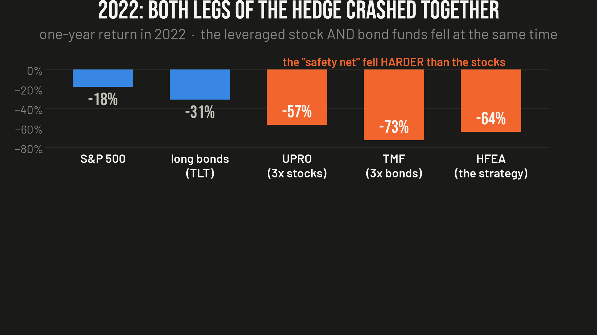
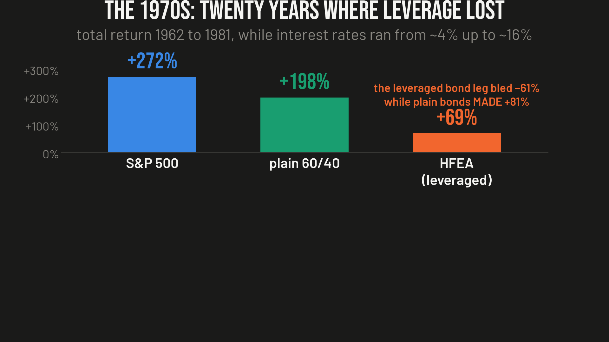

# HedgeFundie's Excellent Adventure (HFEA) — Kill-Test (Backtest Graveyard source)

**Episode:** Ep17 · **Channel:** The Backtest Graveyard
**Question:** the famous Reddit/Bogleheads strategy: hold **55% UPRO (3x S&P 500) + 45% TMF (3x 20+ year Treasuries), rebalanced quarterly.** The pitch is that stocks and long bonds move opposite each other, so you can leverage both three times and the bond leg cushions the stock crashes. Real idea, or a leveraged bet on a bond bull that's already over?
**Data:** two regimes, both run, kept separate.
- **REAL (the actual funds):** UPRO, TMF, SPY, AGG and TLT daily **total-return** closes (adjustment=all) from **Alpaca SIP**, window **2016-01-04 → 2026-09-17** (2,692 trading days, 10.7 years).
- **SIM (before the funds existed):** the equity leg is the **Fama-French daily total-return US market** (CRSP, S&P 500 total-return proxy, daily correlation ≈ 0.99). The Treasury leg is a synthetic long-Treasury total-return index built from **FRED DGS10** (10-year constant-maturity yield) by repricing a rolling 10-year par bond every day, plus daily coupon accrual. Each 3x leg is modeled as **`3×index − 2×short rate − expense`** (the fund borrows 2x notional and pays the 1-month T-bill rate on it; expense 0.92%/yr UPRO, 1.06%/yr TMF). Window **1962-01-02 → 2026-07-31** (16,253 trading days, 64.6 years).

**Why this source:** Alpaca SIP only reaches back to 2016, so the REAL window leaves out HFEA's 2009–2015 glory years. That cut is unfavorable to HFEA (it drops its best stretch), but the window still holds the two events that decide the question: the 2020 COVID crash, where the hedge worked, and 2022, where it didn't. stooq.com (full history) sits behind a JavaScript proof-of-work bot wall and Yahoo's chart API rate-limited every request (429). I did not try to get around either. The SIM exists because the real funds never lived through a long rising-rate era, and 1962 is as far back as daily long-Treasury data goes without a bot wall. It covers the whole 1962–1981 bond bear (10-year yield 4.06% → 15.84%).
**Disclosed caveat:** DGS10 is a 10-year yield (duration about 8). TMF actually holds 20+ year bonds (duration about 17). So the SIM **understates** how badly the leveraged bond leg gets hurt when rates rise. That's on purpose, and it makes the SIM conservative, kind to HFEA.
**Method:** long-only, daily close, quarterly rebalance unless stated. Compared against S&P 500 buy-and-hold, a 60/40 stock/bond mix rebalanced quarterly (SPY/AGG in REAL, the sim legs unleveraged in SIM), and UPRO alone as a reference. Ranked by **MAR = CAGR / max drawdown**, because the whole HFEA pitch is a better risk-adjusted ride, not just more dollars. Bar to pass: **MAR ≥ 0.50 AND Sortino ≥ 1.00.**

Code: `backtest_hfea.py` (Python standard library only; no secrets, no accounts). It reads a free Alpaca market-data key from the environment for the REAL regime, downloads FRED with no key, caches the raw data next to itself, prints every figure below and writes `curve_data.json`. The two charts are drawn from those numbers.

## Headline

**Same money as the S&P, twice the crash, and the hedge broke in 2022.** In the real 2016+ record HFEA turned $1 into **$4.65** against plain S&P buy-and-hold's **$4.46**. Basically a tie. To get that tie you sat through a **−70.5%** drawdown (the S&P's worst was −33.8%) that needs **+239%** just to get back to even, and it's been underwater **1,725 days** (about 4.7 years) and still counting. In 2022 both legs fell together: **UPRO −56.8%, TMF −72.6%, HFEA −64.1%**, because the daily stock/bond correlation went from **−0.34 (2016–19) to +0.08 (2022)**. Run the sim back through the 1962–1981 rate rise and HFEA made **+68.9%** in twenty years while plain stocks made **+272%**.

## Results

**REAL ETFs, 2016-01-04 → 2026-09-17**

| Strategy | Total return | $1 became | CAGR | MAR | Sortino | Max DD | Worst year | Longest underwater | Vol | Bar |
|---|--:|--:|--:|--:|--:|--:|--:|--:|--:|:--:|
| 60/40 SPY/AGG (Q-reb) | +174.4% | $2.74 | 9.9% | **0.47** | 1.30 | −21.0% | 2022 −15.9% | 763 d | 10.8% | fail |
| S&P 500 total-return buy & hold | +345.5% | $4.46 | 15.0% | **0.44** | 1.25 | −33.8% | 2022 −18.2% | 709 d | 17.5% | fail |
| UPRO alone (3x S&P), reference | +1,450.1% | $15.50 | 29.2% | **0.38** | 1.06 | −76.8% | 2022 −56.8% | 896 d | 52.0% | fail |
| **HFEA 55/45 UPRO/TMF (Q-reb)** | +364.8% | $4.65 | 15.4% | **0.22** | 0.85 | −70.5% | 2022 −64.1% | 1,725 d | 32.2% | fail |

**SIMULATED 3x, 1962-01-02 → 2026-07-31**

| Strategy | Total return | $1 became | CAGR | MAR | Sortino | Max DD | Worst year | Longest underwater | Vol | Bar |
|---|--:|--:|--:|--:|--:|--:|--:|--:|--:|:--:|
| 60/40 sim (Q-reb) | +28,523% | $286 | 9.2% | **0.29** | 1.36 | −31.2% | 2022 −18.3% | 1,222 d | 9.8% | fail |
| **HFEA 55/45 sim (Q-reb)** | +1,061,202% | $10,613 | 15.4% | **0.21** | 0.96 | −72.0% | 2022 −51.8% | 2,097 d | 26.5% | fail |
| S&P 500 TR buy & hold (sim) | +66,291% | $664 | 10.6% | **0.19** | 0.99 | −54.6% | 2008 −36.5% | 2,404 d | 16.2% | fail |
| UPRO-sim alone (3x S&P) | +357,647% | $3,577 | 13.5% | **0.14** | 0.71 | −97.8% | 2008 −85.1% | 6,433 d | 48.5% | fail |

Nothing clears the bar. A 10-year window that ends with HFEA still underwater sinks every max-drawdown denominator, and the sim has 1974 and 2008 in it. Read the tables relative. In the real window HFEA made the same money as the S&P (CAGR 15.4% vs 15.0%) with about **2.1x the drawdown**, and it has the worst MAR and worst Sortino on the board. Over 64 simulated years the leverage does edge out plain stocks on MAR (0.21 vs 0.19), but unleveraged 60/40 beats both (0.29) with less than half the drawdown. The million-percent number is the part people quote. The −72% (1972–74) is the part they don't.

## Kill-Test 1 — 2022, both legs fell together



| 2022 calendar year | Return |
|---|--:|
| SPY | −18.2% |
| TLT (1x long bonds) | −31.2% |
| UPRO (3x stocks) | −56.8% |
| TMF (3x bonds) | −72.6% |
| **HFEA** | **−64.1%** |

The bond leg didn't cushion anything. It was a second leveraged long into the same rising-rate shock, and it fell harder than the stocks. HFEA's full-window max drawdown is **−70.5%** (peak 2021-12-27, trough 2023-10-27), **−67.0%** of it inside 2022 alone.

The reason is the correlation. SPY vs TLT daily return correlation was **−0.34 in 2016–2019, −0.45 in 2020, and +0.08 in 2022.** The whole strategy needs that number to be negative. In 2022 it went positive, in exactly the inflation and rising-rate regime the hedge is supposed to survive.

## Kill-Test 2 — When the hedge worked (2020) and when it broke (2022)

COVID crash, 2020-02-19 to 2020-03-23: **UPRO −76.8%, TMF +35.5%.** The bond leg rallied while stocks fell, HFEA drew down −45.4% (a lot less than UPRO alone) and came back fast. That's the real idea working.

2022 is the same wrapper with the opposite result. The difference between the two years is the macro regime, not anything the strategy did. You don't get to pick which regime you retire into.

## Kill-Test 3 — Drawdown

HFEA's −70.5% needs **+239%** to break even. Longest time underwater is **1,725 days** (about 4.7 years), from 2021-12-27, and still open at the end of the data. The S&P over the same window: −33.8% max drawdown, 709 days underwater.

The backtest assumes you keep calmly rebalancing into a −70% hole for years. Most people don't. Selling at the bottom locks in the one outcome the backtest never models.

## Kill-Test 4 — 3x the fund is not 3x the result

| Leg | 1x fund | 3x fund | Naive "3x the return" | What 3x actually did |
|---|--:|--:|--:|--:|
| Stocks | SPY ×4.46 (+345%) | UPRO ×15.50 (+1,450%) | ×11.37 | 4.20x the index return |
| Bonds | TLT ×0.91 (−9.4%) | TMF ×0.19 (−80.7%) | ×0.72 | 8.62x the index loss |

In a steady bull, daily-reset leverage compounds above 3x on the way up. That's the half people see. On the bond leg, decay plus financing during the 2022 rate spike turned a −9% unleveraged loss into a −81% wipeout. You pay borrowing costs and expenses on two leveraged funds every day, and the bond leg's financing cost goes up right when rates do.

## Kill-Test 5 — Rebalance timing

| Rebalance | CAGR | Max DD | MAR | 2022 return | Rebalances |
|---|--:|--:|--:|--:|--:|
| Never (buy & hold 55/45) | 22.3% | −65.0% | 0.34 | −59.1% | 0 |
| **Quarterly (the recipe)** | 15.4% | −70.5% | 0.22 | −64.1% | 42 |
| Monthly | 13.2% | −69.9% | 0.19 | −62.9% | 128 |
| Annual | 11.5% | −69.0% | 0.17 | −63.5% | 10 |

Rebalancing hurt in this window and hurt most in 2022. Every quarter it sold the less-bad leg to top up the collapsing TMF leg, so the disciplined recipe lost more in 2022 (−64.1%) than doing nothing (−59.1%). Rebalancing pays off when the legs move opposite each other. When both trend down together it just feeds the loser. Quarterly rebalancing is not downside protection.

## Kill-Test 6 — The rising-rate era, 1962–1981 (SIM)



The 10-year yield went from **4.06% to 15.84%**. Twenty years of bond bear market, the long version of 2022.

| Strategy | 1962–1981 total | 1962–1981 max DD |
|---|--:|--:|
| **HFEA sim** | **+68.9%** | **−72.0%** |
| S&P 500 TR (sim) | +272.1% | −48.2% |
| 60/40 sim | +197.9% | −31.2% |
| UPRO-sim (3x S&P) | +76.6% | −91.9% |
| **TMF-sim (3x 10-yr Treasury)** | **−60.9%** | **−71.9%** |
| Long Treasury 1x (sim) | +80.9% | −20.2% |

The 3x Treasury leg lost **−60.9%** over twenty years while the plain long bond made **+80.9%**. A slow bond bear you can sit through in 1x becomes a grind to a stub in 3x, especially when the financing cost rises with the same rates that are sinking the bonds. HFEA made +68.9% across two decades, behind plain stocks and behind plain 60/40, with a −72% drawdown on the way. This is the era HFEA's 2009–2021 record never saw. The strategy was born near the start of the biggest bond bull on record, and that's what its backtest was fit to.

## Kill-Test 7 — How you model financing changes everything (SIM)

| HFEA-sim financing model | Full-window CAGR | 1962–1981 total |
|---|--:|--:|
| Rate-aware: `3×index − 2×short rate − expense` | 15.4% | **+68.9%** |
| Flat 1%/yr drag, no rate term | 25.7% | **+1,577%** |

A flat borrowing fee is what a lot of rosy HFEA backtests quietly assume. The real cost of a 3x fund is about 2x the short rate, and the short rate spikes during inflations, right when the leverage is already losing. That one modeling choice turns +69% over two decades into a made-up +1,577%. It's where most of the "HFEA survived the 70s" backtests come from.

## Kill-Test 8 — Stock/bond correlation isn't a constant (SIM)

| Decade | Stock/long-bond daily correlation |
|---|--:|
| 1960s | +0.10 |
| 1970s | +0.26 |
| 1980s | +0.30 |
| 1990s | +0.26 |
| 2000s | −0.33 |
| 2010s | −0.45 |
| 2020s | −0.07 |

The negative correlation HFEA depends on is basically a 2000–2020 thing. From 1962 through 1999 it was positive, stocks and bonds falling together, which is what 2022 looked like. The hedge is a regime, not a law, and the regime that makes HFEA work is the recent, unusual one.

Over the full 64 years on the sim legs, leverage didn't help the bond side at all: long Treasury 1x ×37.80, TMF-sim ×39.67, against a naive "3x the return" of ×111.41. On the equity side, S&P TR ×663.9 and UPRO-sim ×3,577.5 (naive ×1,989.7), with a −97.8% max drawdown along the way.

## The GREEN keeper

The core idea is real. Holding assets that genuinely don't move together and rebalancing between them (risk parity) is sound, and that's why **unleveraged 60/40 had the best MAR in both windows: 0.47 real, 0.29 sim**, with the smallest drawdowns both times. Diversification across real return drivers works. Keep that.

What turns it into a graveyard entry is two things bolted on: 3x leverage, which turns a normal bad year into a −70% hole and charges a rate-sensitive financing bill on two funds every day, and the assumption that the stock/bond hedge always holds, when it breaks in exactly the inflation and rising-rate regimes (1962–1999, 2022) where you need it. Take the leverage off and you have a sensible 60/40.

To be fair to HFEA's defenders: over 64 simulated years it did beat 100% stocks on MAR (0.21 vs 0.19), and 2020 shows the hedge really working. It isn't a scam. It's a concentrated macro bet dressed up as a diversified portfolio.

## Verdict

**THE HEDGE BROKE.** HFEA is a leveraged bet on the 40-year bond bull, and the bull ended. In the real record it made no more money than the S&P with about twice the drawdown. Its million-percent long-history version depends on financing assumptions that ignore rising rates and on a stock/bond correlation that was only negative for two of the last six decades. 2020 shows the hedge is real. 2022 shows it's conditional, with both legs down 57% and 73% in the same year. Plain 60/40 won on risk-adjusted return in both windows.

## Reproduce

```bash
# REAL regime needs a free Alpaca market-data key
export ALPACA_KEY=...  ALPACA_SECRET=...      # or put them in ~/.alpaca/credentials
python3 backtest_hfea.py
```

FRED DGS10 and the Fama-French daily factors download with no key. Ken French adds new months to his file and revises old ones, FRED revises too, and adjusted closes move as new dividends post, so a fresh run can extend the simulated window past 2026-07-31 and shift the long-history figures slightly; `curve_data.json` here was produced from the 2026-09-17 downloads. Not investment advice. One person's research; if you find an error, open an issue.
