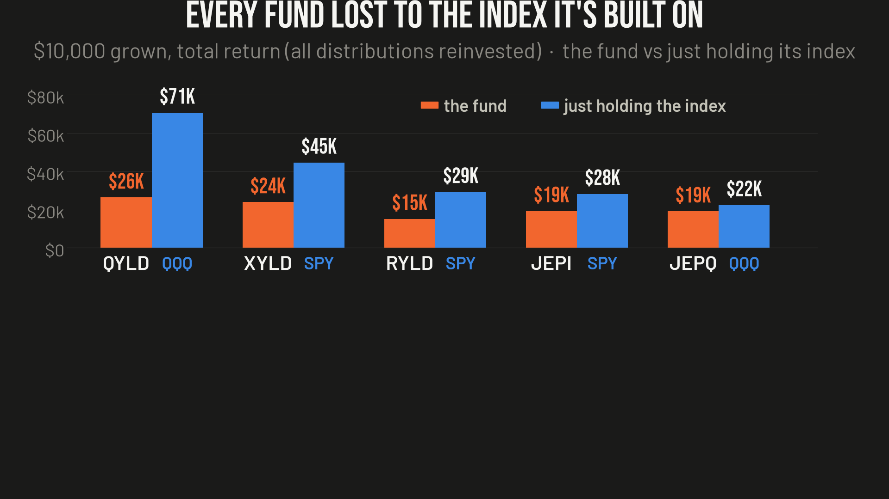
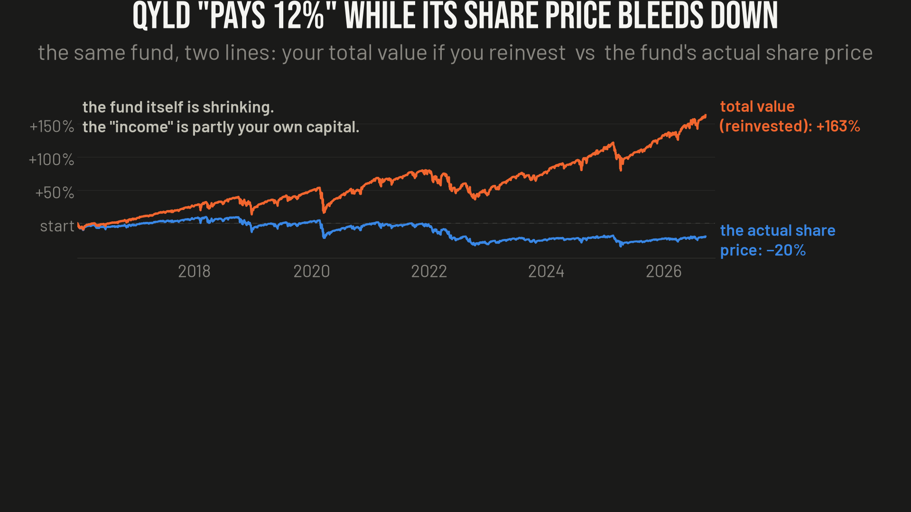

# Covered-Call "Income" ETFs — Kill-Test (Backtest Graveyard source)

**Episode:** Ep18 · **Channel:** The Backtest Graveyard
**Question:** the most-marketed "passive income" product in retail: the covered-call / buy-write **income ETFs**, **QYLD, XYLD, RYLD** (Global X) and **JEPI, JEPQ** (JPMorgan). The pitch is "9–12% yield, monthly income, lower volatility, income in retirement." Is that yield real income, and does it equal your return?
**Data:** **Alpaca SIP** daily bars. For every fund I pulled **both** (a) **total return** (`adjustment=all`, price plus all distributions reinvested) and (b) **price / NAV** (`adjustment=raw`, the actual unadjusted share price). The gap between the two is the story. Underlyings (total return): **QQQ** for QYLD and JEPQ, **SPY** for XYLD, RYLD and JEPI. Longest clean window per fund (SIP reaches back to 2016-01-04):

| Fund | Window used | Inception | Note |
|---|---|---|---|
| QYLD | 2016-01-04 → 2026-09-17 (10.7y) | 2013-12 | pre-2016 lost to SIP |
| XYLD | 2016-01-04 → 2026-09-17 (10.7y) | 2013-06 | pre-2016 lost to SIP |
| RYLD | 2019-04-22 → 2026-09-17 (7.4y) | 2019-04 | full history |
| JEPI | 2020-05-21 → 2026-09-17 (6.3y) | 2020-05 | full history |
| JEPQ | 2022-05-04 → 2026-09-17 (4.4y) | 2022-05 | full history |

**Why this source:** stooq.com would reach back to 2013, but it sits behind a JavaScript proof-of-work bot wall. I did not try to get around it, so this uses the 2016+ SIP window and says so.
**Disclosed caveat:** the windows differ. Each fund is compared only to its own index over its own window. JEPI and JEPQ have short records (2020+ and 2022+) that leave out the 2016–2021 bull, which is exactly the stretch where capping your upside costs the most. Their numbers below look better partly because of when they launched.
**Method:** buy and hold, daily close, each fund against its underlying index over the identical dates. Ranked by **MAR = CAGR / max drawdown**, because these funds are sold as a smoother, lower-risk ride and a fair judge prices risk, not just dollars. Bar to pass: **MAR ≥ 0.50 AND Sortino ≥ 1.00.** "Trail Yield" is the reinvested-income leg over the trailing ~year, a data-derived stand-in for the marketed distribution yield (not the fund's stated SEC yield).

Code: `backtest_covered_calls.py` (Python standard library only; no secrets, no accounts). It reads a free Alpaca market-data key from the environment, caches the raw data next to itself, prints every figure below and writes `curve_data.json`. The two charts are drawn from those numbers.

## Headline

**The yield is real. The return isn't.** Every covered-call fund badly trailed its own index's total return, because it sold the upside for premium. Flagship case: **$10,000 in QYLD grew to $26,315. The same $10,000 in QQQ grew to $70,742** over the identical decade. You gave up **$44,427**. And the "12% yield" is partly your own money: **QYLD's share price fell −19.9%** (from $23.12 to $18.51) across ten years of paying about 12%. The one thing the wrapper really delivers is a **smoother ride** (QYLD vol 15.4% vs QQQ 22.2%; JEPI 10.7% vs SPY 16.8%). But if what you want is income, the DIY test settles it: QYLD's holder took **$12,412** of income and had **$8,006** of fund left. Someone who held QQQ and sold shares for the *same* $12,412 had **$33,015** left. Same spending, **+$25,009**.

## Results

**Every fund vs its underlying (both total return), ranked by MAR**

| Series | Window | Total return | CAGR | MAR | Sortino | Max DD | Vol | Trail Yield | Bar |
|---|---|--:|--:|--:|--:|--:|--:|--:|:--:|
| QQQ total return | 2022→ | +123.6% | 20.2% | **0.89** | 1.37 | −22.8% | 22.4% | (index) | PASS |
| **JEPI** (total return) | 2020→ | +92.1% | 10.9% | **0.79** | 1.46 | −13.7% | 10.7% | 8.3% | PASS |
| **JEPQ** (total return) | 2022→ | +90.6% | 15.9% | **0.79** | 1.39 | −20.1% | 16.7% | 12.2% | PASS |
| SPY total return | 2020→ | +182.2% | 17.8% | **0.73** | 1.53 | −24.5% | 16.8% | (index) | PASS |
| QQQ total return | 2016→ | +607.4% | 20.1% | **0.57** | 1.33 | −35.0% | 22.2% | (index) | PASS |
| SPY total return | 2019→ | +192.4% | 15.6% | **0.46** | 1.20 | −33.8% | 19.2% | (index) | fail |
| SPY total return | 2016→ | +345.8% | 15.0% | **0.44** | 1.25 | −33.8% | 17.5% | (index) | fail |
| **QYLD** (total return) | 2016→ | +163.2% | 9.5% | **0.38** | 0.91 | −24.7% | 15.4% | 12.8% | fail |
| **XYLD** (total return) | 2016→ | +139.1% | 8.5% | **0.25** | 0.88 | −33.5% | 14.1% | 11.3% | fail |
| **RYLD** (total return) | 2019→ | +50.9% | 5.7% | **0.14** | 0.55 | −41.6% | 16.7% | 12.9% | fail |

**Head-to-head, over the same window, every fund loses to its index on total return:** QYLD −444pp vs QQQ, XYLD −207pp vs SPY, RYLD −142pp vs SPY, JEPI −90pp vs SPY, JEPQ −33pp vs QQQ.

JEPI and JEPQ are the two funds that clear the bar, and that needs saying plainly: they pass on **risk-adjusted** grounds over short 2020+ and 2022+ windows that leave out the 2016–2021 bull. They did not make more money. Their indexes made more, on the same dates. The Global X funds, with the full decade, all fail.

## Kill-Test 1 — Total return vs the index



$10,000 at each fund's start, total return (distributions reinvested):

| Pair | Window | $10k → Fund | $10k → Index | You gave up |
|---|---|--:|--:|--:|
| QYLD vs QQQ | 2016→ | **$26,315** | **$70,742** | **$44,427** |
| XYLD vs SPY | 2016→ | $23,911 | $44,582 | $20,671 |
| RYLD vs SPY | 2019→ | $15,085 | $29,245 | $14,159 |
| JEPI vs SPY | 2020→ | $19,211 | $28,219 | $9,008 |
| JEPQ vs QQQ | 2022→ | $19,065 | $22,358 | $3,293 |

Every covered-call fund lagged its own index. That isn't a bug, it's the mechanism. A covered call caps your upside at the strike in exchange for a premium. In a bull market the calls keep getting exercised away and you're left with the small premium instead of the gains. QYLD (mechanical at-the-money writing on the Nasdaq-100) gave up the most because the Nasdaq-100 ran the hardest. The gap is smaller for JEPI and JEPQ partly because their windows miss the 2016–2021 bull, and partly because they write further out of the money on a lower-volatility stock sleeve.

## Kill-Test 2 — The yield illusion: NAV erosion



| Fund | Share price (NAV) start → end | NAV change | While paying about |
|---|---|--:|--:|
| **QYLD** | $23.12 → $18.51 | **−19.9%** | 12.8%/yr |
| XYLD | $43.26 → $41.70 | −3.6% | 11.3%/yr |
| **RYLD** | $25.03 → $15.87 | **−36.6%** | 12.9%/yr |
| JEPI | $50.10 → $56.23 | +12.2% | 8.3%/yr |
| JEPQ | $51.09 → $59.92 | +17.3% | 12.2%/yr |

QYLD's share price fell for a decade while it advertised a ~12% yield. Its total return was still +163.2%, but all of that came from distributions: the income leg was **+228.7%** while the price **fell −19.9%**. When a fund pays out more than it earns, the difference comes out of NAV. That's return of capital: the fund hands you back your own money and calls it yield. RYLD is worse (NAV −36.6%).

The split is clean. The mechanical Global X funds eroded their NAV. The actively managed JPMorgan funds grew theirs. That's the clearest reason JEPI-style is more defensible than QYLD-style. A high distribution rate on a falling share price is not income. It's a slow liquidation with a monthly statement.

## Kill-Test 3 — The DIY test: homemade income beats the fund

For each fund: hold it and **spend** every distribution (so what you have left follows the share price). The DIY twin: hold the index (total return) and withdraw the **exact same dollars** on the same days. Identical cash out the door. Compare what's left at the end, on a $10,000 start.

| Fund vs DIY index | Window | Cash income taken (both) | Fund left | DIY left | DIY advantage |
|---|---|--:|--:|--:|--:|
| **QYLD vs QQQ** | 2016→ | $12,412 | $8,006 | **$33,015** | **+$25,009** |
| XYLD vs SPY | 2016→ | $11,003 | $9,639 | $20,070 | +$10,430 |
| RYLD vs SPY | 2019→ | $8,495 | $6,340 | $12,907 | +$6,567 |
| JEPI vs SPY | 2020→ | $6,796 | $11,224 | $16,526 | +$5,303 |
| JEPQ vs QQQ | 2022→ | $5,418 | $11,727 | $13,271 | +$1,544 |

Same cash flow, more money left, every time, including against the better funds (JEPI +$5,303, JEPQ +$1,544). You don't need the fund to make income. Holding the index and selling a sliver of shares keeps the upside the covered call sold away, and you control the timing and tax character of your own sales. The model assumes 0% on uninvested cash and ignores per-sale tax lots. Taxes would make the DIY side look better, not worse: the funds' distributions are largely ordinary income (and for the Global X funds partly return of capital), while DIY sales are mostly long-term gains.

## The GREEN keeper

The smoother ride is real. Every fund was less volatile than its index:

| Pair | Fund vol | Index vol | Fund Sortino | Index Sortino |
|---|--:|--:|--:|--:|
| QYLD vs QQQ | **15.4%** | 22.2% | 0.91 | 1.33 |
| XYLD vs SPY | **14.1%** | 17.5% | 0.88 | 1.25 |
| RYLD vs SPY | **16.7%** | 19.2% | 0.55 | 1.20 |
| JEPI vs SPY | **10.7%** | 16.8% | 1.46 | 1.53 |
| JEPQ vs QQQ | **16.7%** | 22.4% | 1.39 | 1.37 |

Selling calls trades away the right tail, which mechanically damps volatility. JEPI stands out: 10.7% vol, about a third below SPY, with a nearly matching Sortino (1.46 vs 1.53), and its NAV grew. That's a legitimate product for a narrow case: a retiree who needs cash flow now, has low tolerance for swings, holds it in a tax-advantaged account, and is willing to give up growth for a steadier check. If someone insists on this category, active JEPI-style (out-of-the-money calls on a lower-volatility stock sleeve) is the honest version. JEPI trailed SPY by 90pp but grew its NAV. QYLD trailed QQQ by 444pp *and* lost −19.9% of its NAV.

What it is not: free 12% yield. The yield is not your return.

## Verdict

**PAID WITH YOUR OWN MONEY. The yield is real, the return isn't.** The checks show up every month as advertised, but part of them is your own principal coming back (QYLD NAV −19.9% over a decade), and the total return badly lags just owning the index ($10k → $26,315 in QYLD vs $70,742 in QQQ). The one real benefit is a smoother, lower-volatility ride, which matters for a narrow slice of income-first retirees in a tax shelter. For anyone building wealth, owning the index and selling what you need delivered the identical cash flow and left more money every time.

## Reproduce

```bash
# needs a free Alpaca market-data key
export ALPACA_KEY=...  ALPACA_SECRET=...      # or put them in ~/.alpaca/credentials
python3 backtest_covered_calls.py
```

Adjusted closes move as new distributions post, so a fresh run will extend the window past 2026-09-17 and shift the figures slightly; `curve_data.json` here was produced from the 2026-09-17 downloads. Expense ratios (QYLD/XYLD/RYLD 0.60%, JEPI/JEPQ 0.35%) are already inside the total-return series; taxes are described, not modeled. Not investment advice. One person's research; if you find an error, open an issue.
