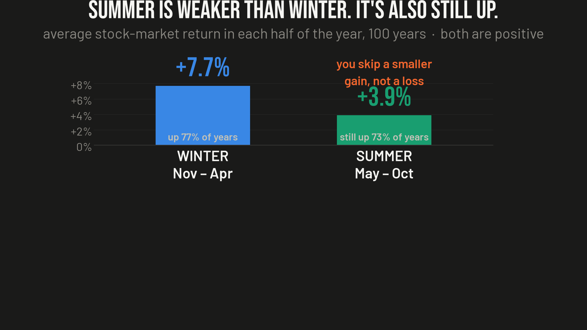
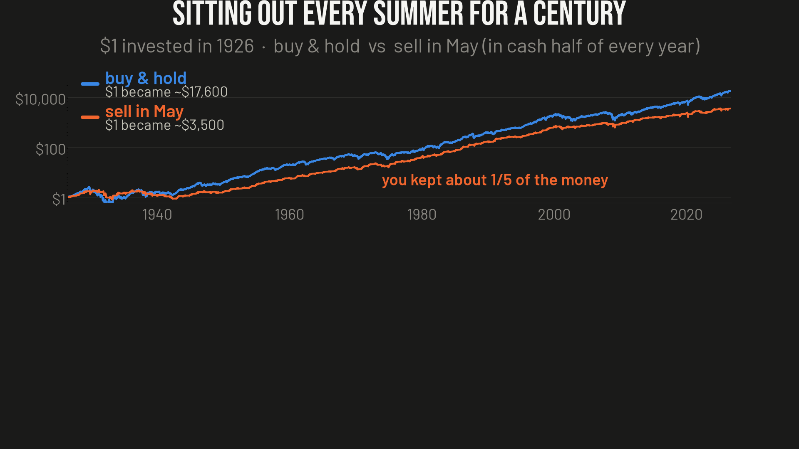

# Sell in May and Go Away — Kill-Test (Backtest Graveyard source)

**Episode:** Ep19 · **Channel:** The Backtest Graveyard
**Question:** the oldest calendar rule in the market, the "Halloween indicator," better known as **"Sell in May and go away."** The folklore says stocks are weak May through October, so you sit out every summer and buy back in for November through April, every year. Is summer actually dangerous, or just weaker? And is there a trade in it, or only a season?
**Data:** daily **total return** (dividends reinvested) from the **Fama-French daily research factors** (Ken French data library, Dartmouth). `Mkt = (Mkt-RF + RF)` is the daily total return of the value-weighted US stock market (CRSP), compounded into a total-return index. `RF` is the daily risk-free (1-month T-bill) return, used for cash. Window **1926-07-01 → 2026-07-31**: 26,296 trading days, **100.1 years**.
**Why this source:** the whole question is whether summer weakness is a century-long pattern or a few autumn crashes wearing a costume. So the test has to contain those crashes. Fama-French has no bot wall and reaches **Oct 1929, Oct 1987, Oct 2008 and 2020**, every autumn crash that built the legend. It's the total US market, used as an **S&P 500 total-return proxy** (daily correlation with the S&P ≈ 0.99). Cash earns the **T-bill rate (mean ~3.1%/yr over the century)**, not 0%. Modeling cash at 0% would unfairly punish a strategy that's out half the year.
**Method:** long-only, decided on the daily close by a **pure calendar rule**. There's no lookahead by construction, because the calendar is known in advance. 5 bps one-way switching cost. Ranked by **MAR = CAGR / max drawdown**, the channel standard, and read *relative to buy and hold*: the 1929-32 −84% collapse sits in every strategy's denominator, and nothing that includes it clears an absolute 0.50.

Code: `backtest_sell_in_may.py` (Python standard library only, no secrets, no accounts). It downloads the Fama-French daily file on first run, caches it next to itself, prints the figures below and writes `curve_data.json`. The two charts are drawn from those numbers.

## Headline

**The season is real. The trade is not.** Winter (Nov–Apr) beat summer (May–Oct) by **~3.8%/yr** over 100 years, and it has *not* faded. But summer is still **positive**. It averaged **+3.9%** and was up in **73%** of years. Sell in May doesn't dodge losses. It skips six months of smaller, real gains every single year. Over the century that turned **$1 into ~$3,502** against buy and hold's **~$17,630**, so sitting in cash half of every year kept you just **~20%** of the wealth. You did buy a smaller drawdown (**−58.9% vs −84.1%**) and a slightly better MAR and Sortino. The price was **~1.8%/yr and ~80% of your ending money.** And the "summer is weak" edge is fragile: strip out the 3 worst summers (1930, 1931, 2008) and **27% of the winter-over-summer gap evaporates.** A lot of it is a handful of bad Octobers, not a drift you can bank on in any given year.

## Results

**Ranked by MAR (the channel standard, not raw return)**

| Rank | Strategy | Total Ret | CAGR | **MAR** | Sortino | Max DD | Worst Yr | Underwater | Vol | %Inv | Switches | Bar |
|--:|---|--:|--:|--:|--:|--:|--:|--:|--:|--:|--:|:--:|
| 1 | **Sell in May (hold Nov–Apr)** | +350,100% | 8.5% | **0.14** | 1.06 | **−58.9%** | 1932 −25.3% | 7,252 d | 11.6% | 49% | 200 | fail |
| 2 | **Buy & hold (S&P total ret)** | **+1,762,882%** | **10.3%** | **0.12** | 0.90 | −84.1% | 1931 −44.3% | 5,635 d | 17.1% | 100% | 0 | fail |
| 3 | Inverse (hold May–Oct) | +9,452% | 4.7% | 0.07 | 0.57 | −70.0% | 1930 −29.8% | 4,326 d | 12.6% | 51% | 201 | fail |

Bar to pass: **MAR ≥ 0.50 AND Sortino ≥ 1.00.** Over a century whose denominator is the 1929-32 −84% collapse, **nothing passes.** Buy and hold itself is MAR 0.12. That's what happens when you measure a 100-year max drawdown, and it isn't a verdict on any rule. What matters is the comparison. Sell in May edges buy and hold on MAR (0.14 vs 0.12), Sortino (1.06 vs 0.90), max drawdown and vol, and **loses badly on money.** The inverse, owning only the "bad" summer half, is worse on everything, which confirms the season is real. But even the inverse made money, because summer is positive.

**Modern sub-window (1990-01-02 → 2026-07-31):** same picture, smaller. Sell in May +1,922% / 8.6% CAGR / MAR 0.24 / −35.2% max DD. Buy and hold +4,359% / 10.9% CAGR / MAR 0.20 / −54.6% max DD. Better risk numbers, about 44% of the wealth. The trade-off didn't change in the modern era.

## Kill-Test 1 — Is summer actually negative, or just weaker?

This is the whole ballgame.



| Half | Blocks | Average | Median | Positive |
|---|--:|--:|--:|--:|
| May–Oct (summer) | 101 | **+3.9%** | +4.9% | 73% of years |
| Nov–Apr (winter) | 100 | **+7.7%** | +8.0% | 77% of years |

Winter beats summer by **+3.8%/yr** on average. That's the real, mild seasonal tilt, and it's the honest thing to keep. But summer is clearly positive. The founding premise of the strategy, that summer is *dangerous*, is false. You aren't stepping out of harm's way. You're stepping out of a smaller but real +3.9% average and parking in ~3% cash. Sell in May avoids gains, not losses, roughly 3 years out of 4.

## Kill-Test 2 — $1 since 1926



| Strategy | Total return | CAGR | $1 became |
|---|--:|--:|--:|
| Sell in May | +350,100% | 8.5% | **$3,502** |
| Buy & hold | +1,762,882% | 10.3% | **$17,630** |

Sell in May kept **19.9% of buy and hold's ending wealth.** You gave up **~1.8%/yr of CAGR** by being in cash **51% of the time**, and compounded over a century that gap becomes a **~5× difference** in ending money. Being out six months a year is a brutal drag even though winter is the stronger half, because you're still handing over summer's positive +3.9% average to earn ~3% cash.

## Kill-Test 3 — Crash dependence: is "summer is weak" just a few Octobers?

The 3 worst May–Oct blocks in 100 years: **1930 (−30.8%), 1931 (−29.1%), 2008 (−28.7%).** The Depression and the GFC autumn crash.

| | Avg summer | Winter-over-summer gap |
|---|--:|--:|
| With those 3 | +3.9% | 3.8% |
| Without them | +4.9% | **2.8%** |

**Removing just 3 of 101 summers erases 26.8% of the entire seasonal edge.** The signal leans heavily on a few infamous autumn crashes. It isn't a smooth seasonal drift. In a typical summer (the other 98) the winter advantage is real but small, and you have no way to know ahead of time whether *this* summer is an ordinary +5% one or a 1-in-30 crash. So you're paying for insurance against a lottery-ticket tail, and giving up the median summer's gains to hold it.

## Kill-Test 4 — Post-publication decay: has the edge faded since everyone knew?

The effect has been famous, and academically documented (Bouman & Jacobsen 2002), for decades. If it were pure data-mining you'd expect it to vanish after publication. It didn't.

| Era | Summer avg | Winter avg | Gap | # summers |
|---|--:|--:|--:|--:|
| Pre-1990 | +3.8% | +7.5% | **3.7%** | 64 |
| Post-1990 | +4.0% | +8.1% | **4.1%** | 37 |

The gap did NOT decay. It slightly widened, 3.7% to 4.1%. That's an honest surprise, and it argues *for* the seasonality being a real structural pattern (behavioral, liquidity, bonus-and-holiday flows) rather than a fluke. But a robust season isn't a profitable trade. Post-1990 you'd have sat in T-bills through two of the biggest summer rallies in history: **May–Oct 2009 +19.3%** and **May–Oct 2020 +16.2%**, the two great recovery summers. A durable +4% tilt doesn't come close to paying for missing two +16-19% summers a decade.

## Kill-Test 5 — Tax and trading drag, twice a year, forever

- Switches: **200 over 100 years**, about 2.0 a year (the two calendar flips).
- The explicit switching cost is small: 0 bps → $3,870, **5 bps → $3,502 (base)**, 10 bps → $3,169. Doubling commissions moves CAGR about 0.1%.
- **The real cost the backtest can't fully show is tax.** Buy and hold forces **zero** realizations and defers the whole gain for decades of compounding. Sell in May **forces a sale every May**, realizing gains (often short-term) every year. In a taxable account the after-tax gap is **materially worse than the ~80%-of-wealth shortfall shown here.** The strategy is least bad in a tax-sheltered account, and even there it still loses ~80% of the money.

## Kill-Test 6 — Risk-adjusted: is the summer "seatbelt" worth it?

| | Buy & hold | Sell in May | |
|---|--:|--:|---|
| Max drawdown | −84.1% | −58.9% | 29.9% smaller |
| Volatility | 17.1% | 11.6% | 32.3% lower |
| MAR | 0.12 | 0.14 | |
| Sortino | 0.90 | 1.06 | |

So there IS a real, if small, risk reduction, because being in cash every autumn sidesteps the crash tail. It's smaller than the golden cross's, and bought far more dearly. You paid **~1.8%/yr and ~80% of ending wealth** for a ~30% drawdown cut that mostly comes from dodging a few autumn crashes nobody can predict. For almost any long-horizon investor that's a bad trade. If drawdown is the thing that shakes you out, a permanent lower-equity allocation or a 200-day filter buys a smoother ride without a blanket six-months-in-cash rule.

## The GREEN keeper

The season is real and it has lasted. Winter beat summer by ~3.8%/yr across 100 years, it shows up in 3 of 4 years, and it hasn't decayed since it got famous. That's a legitimately robust calendar fact, which is more than most seasonal folklore can say.

The trade is not. Summer is still positive (+3.9%), most of the winter advantage is a few autumn crashes you can't see coming, and blanket sell-in-May gave up ~80% of a century's wealth to buy a modest, tail-driven drawdown cut. In a taxable account it adds a yearly tax bill on top.

The honest use: don't sell your portfolio each May. If you want to use the seasonality at all, it's a weak argument for **timing new contributions or lump sums toward the Nov–Apr window.** Put fresh cash into the historically stronger half instead of pulling invested money out of the weaker one. Stay invested. Nudge new money, at most.

## Verdict

**A REAL SEASON YOU SHOULDN'T TRADE.** Summer really is the market's weaker half. But weaker means *smaller gains*, not losses, and a big piece of the gap is a handful of autumn crashes. Acting on it, sitting in cash six months a year every year, cost ~1.8%/yr, ~80% of a century's wealth and a yearly tax bill, all to buy a modest drawdown cut you can get more cheaply elsewhere. Keep the calendar on your wall, not in your trading plan. **Don't sell in May. At most, buy in November.**

## Reproduce

```bash
# no key needed: downloads the free Fama-French daily factors on first run and caches them
python3 backtest_sell_in_may.py
```

If the Fama-French download fails, the script falls back to Alpaca SIP daily SPY bars (`adjustment=all`, total return, 2016+ only) plus FRED DTB3 for cash, reading a key from `ALPACA_KEY` / `ALPACA_SECRET` or `~/.alpaca/credentials`. That window is far too short to judge a seasonal effect, and the script prints which source and window it actually used. `curve_data.json` here was produced from the 1926-07-01 → 2026-07-31 Fama-French window. Taxes are described, not modeled. Not investment advice. One person's research, could be wrong. If you find an error, open an issue.
