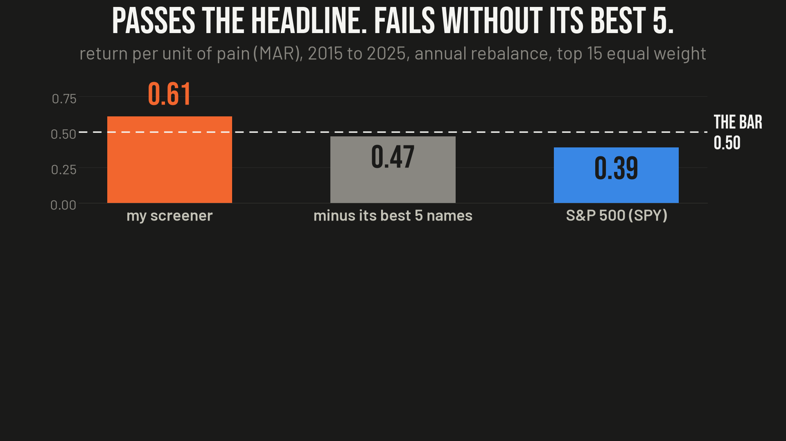
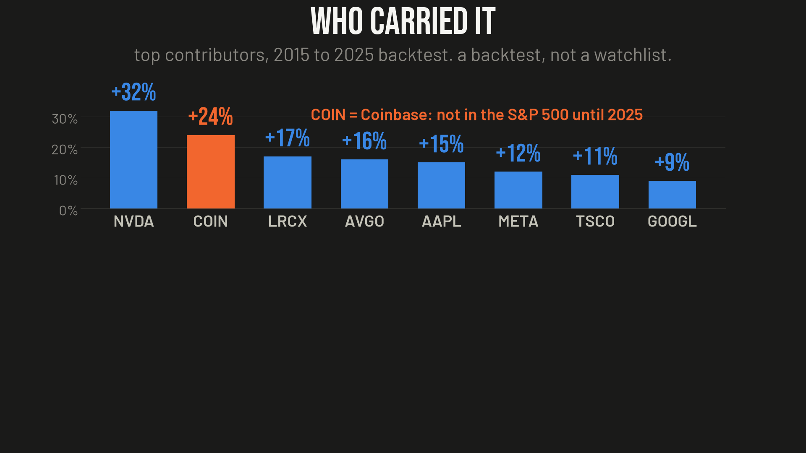
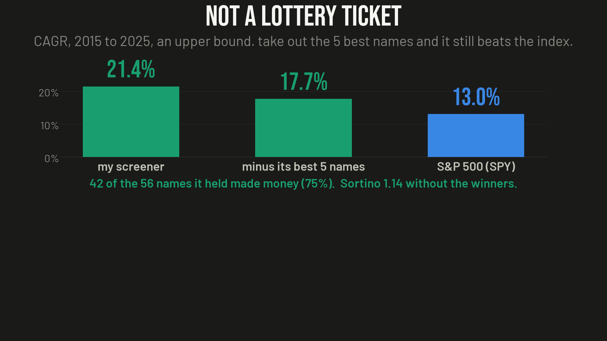
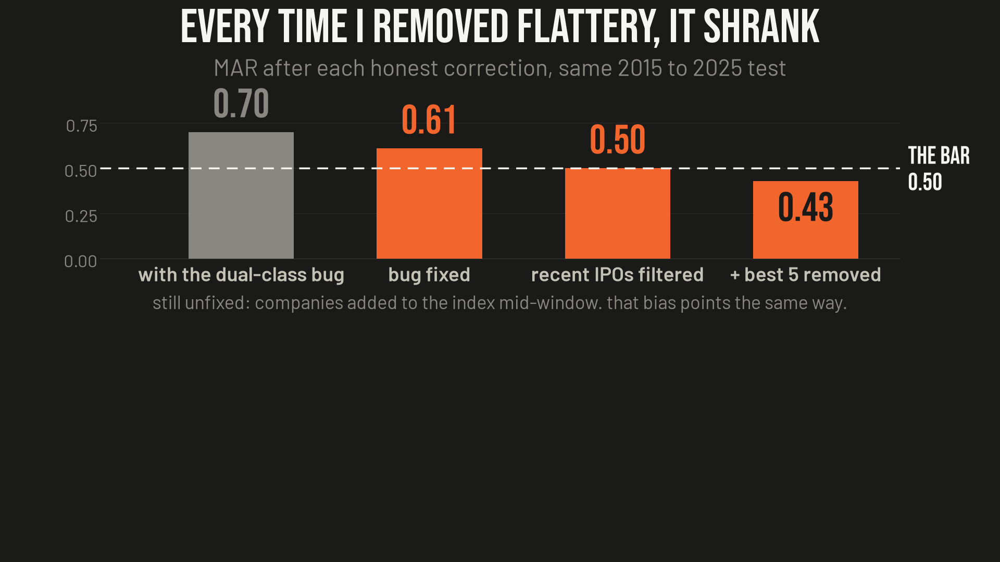

# Ep21: Buffett's Rules, Tested

**Video:** The Backtest Graveyard, Episode 21 (2026-12-08).
**Verdict:** not validated, not disproven. Passes the headline bar, fails the kill-test, and the universe is survivorship-biased.

This folder is findings, charts and the numbers behind them. The screener itself runs privately as an alerts-only tool (it never trades), so its code and its output are not published here.

## Setup

| | |
|---|---|
| Window | 2015-01-02 to 2025-01-02, 10 annual rebalances |
| Universe | today's S&P 500 (503 names). **Survivorship-biased** |
| Portfolio | top 15 by score among names that pass the gates, equal weight |
| Fundamentals | SEC EDGAR, point-in-time (only filings dated on or before each rebalance) |
| Prices | raw close for valuation ratios, adjusted close for returns |
| Costs | 10 bps on turnover each rebalance |
| KPI bar | MAR at least 0.50 **and** Sortino at least 1.0 |

The screen: hard gates (ROE of at least 10%, debt/equity at most 2.0, current ratio at least 1.0, interest coverage at least 3x, positive earnings and free cash flow, $2B market cap), then a quality score and a price score (including a conservative two-stage owner-earnings DCF), combined multiplicatively so both must be good.

## Results

| | CAGR | MaxDD | MAR | Sortino | Total |
|---|---|---|---|---|---|
| Screener | 21.44% | −35.15% | 0.61 | 1.31 | +595.6% |
| Screener, best 5 names removed | 17.66% | −37.42% | **0.47** | 1.14 | +407.0% |
| SPY | 13.00% | −33.72% | 0.39 | 0.95 | +238.7% |
| 5-year filing-history filter | 18.77% | −37.25% | 0.50 | 1.15 | |
| 5-year filter, best 5 removed | 15.71% | −36.34% | **0.43** | 1.05 | |
| + business-model gates and financials valuation (2026-08-10) | 18.74% | −36.29% | 0.52 | 1.16 | drop-5 MAR 0.44 |

## Look-ahead audit: clean

Across 25 companies at two as-of dates, 804,046 facts were admitted and 0 had a filed date after the as-of date. Apple's net income reads $48.4B as of 2018 (FY2017) and $94.7B as of 2022 (FY2021).

## Breadth

56 names held, 42 net-positive (75%). The top 5 were 39% of gross positive P&L. Top contributors: NVDA +32%, COIN +24%, LRCX +17%, AVGO +16%, AAPL +15%, META +12%, TSCO +11%, GOOGL +9%. These are 2015–2025 backtest contributors, not recommendations.

## The survivorship artifact

COIN was the #2 contributor. Coinbase listed in April 2021, after that year's January rebalance, and joined the S&P 500 in 2025, so every year the screener held it, it was a name that was not in the index at the time. Requiring 5 years of filing history removed it and cost 2.7 points of CAGR and 0.11 of MAR. Companies added to the index mid-window are still in the universe, and that remaining bias points the same direction.

## Every time I removed flattery, it shrank

| Step | MAR |
|---|---|
| raw, with a dual-class share bug (two share classes of one company could both be held) | 0.70 |
| dual-class fixed | 0.61 |
| + recent-IPO filter | 0.50 (the bar) |
| + best 5 names removed | 0.43 |

## Limits

- Universe survivorship is unfixed. Results are an upper bound. Settling it needs point-in-time index membership plus delisted names (about $50–70/month of data).
- 10 annual rebalances is a handful of independent observations.
- The sell rules aren't simulated. Positions are held to the next rebalance.

## What's in this folder

- `results.json`: every number in this README, transcribed by hand from my research note's tables, with section refs in each key. Nothing was re-run for this folder.
- `charts/`: the four charts from the episode (kill-test, contributors, best 5 removed, the correction ladder).

## Reproduce (you can't, fully, and here's why)

The backtest code isn't here. It shares its scoring code with the screener that's still running, and I only publish the method and the results, never anything that would show what it flags today. The data side is all free: SEC EDGAR `companyfacts` for fundamentals (point-in-time by filed date) and daily closes for prices. The method is in Setup above. **The results are reproducible only from the numbers in `results.json`.** Every number in this README traces to it, except Coinbase's April 2021 listing date, which is public record.

**Call:** not validated, no capital. Kept as a discovery tool that produces a short list for human review.

Not investment advice.
